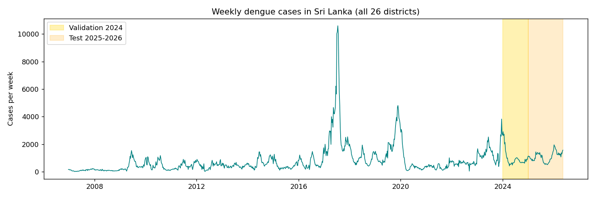
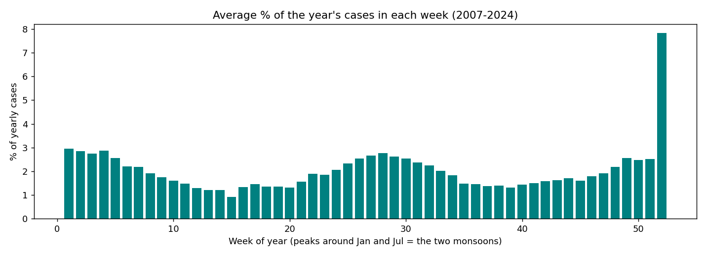
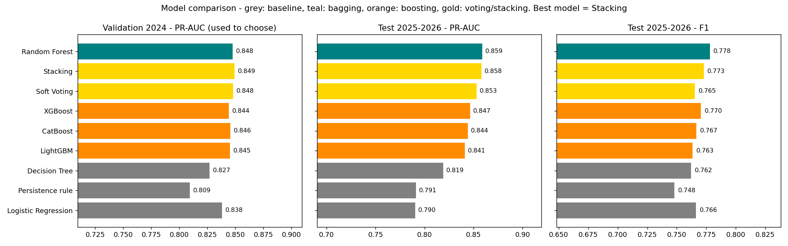
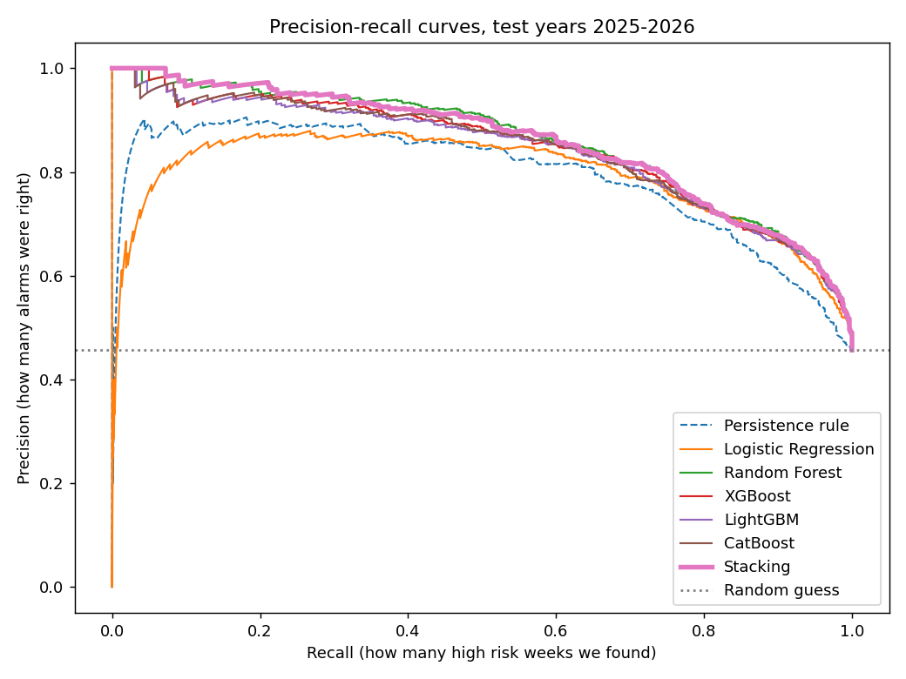
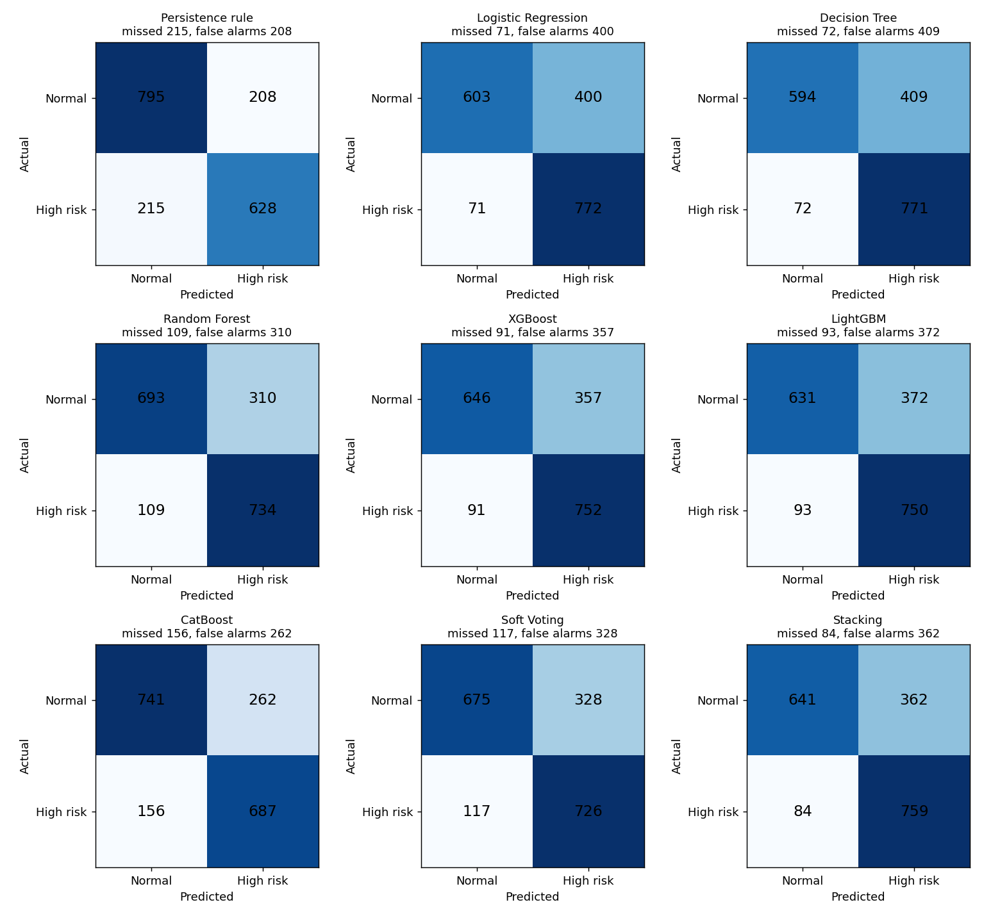
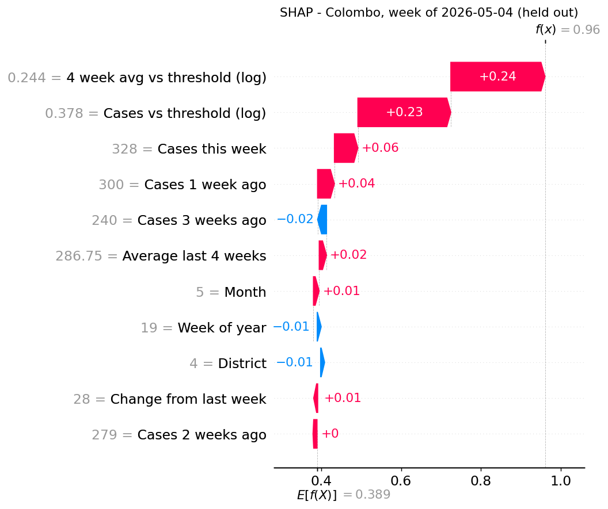
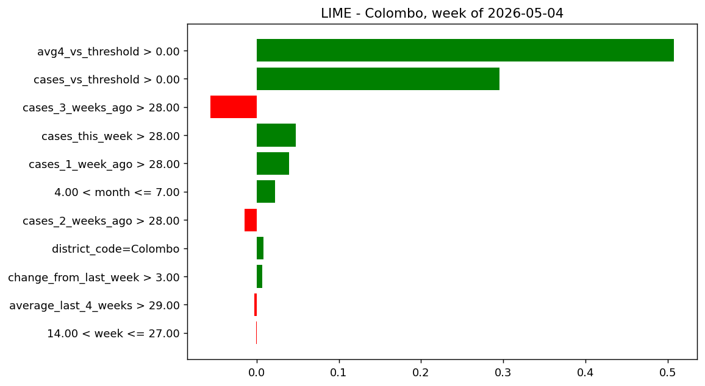
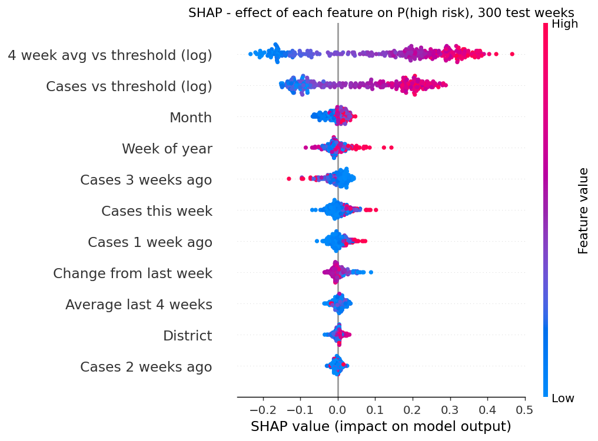

# Results

Models were trained on **2007-2023**, the best model was chosen using **2024** (validation),
and the final test was done once on **2025-2026** (1,846 district-weeks).
The week of 2026-05-04 was kept out completely for inference.

## 1. What I found in the data (EDA)

- 26,311 rows, 26 districts, Dec 2006 - May 2026. No nulls, no duplicates.
  **Puttalam was missing one week** -> I filled it with interpolation.
- The weekly cases are very skewed (median 9, max 2,631, skewness 10.2).
  After `log(1 + x)` the skewness is 0.2 -> I use a log transform.
- Colombo, Gampaha and Kalutara (Western Province) have 41% of all cases. Colombo's threshold is
  224.5 cases, Mannar's is 3 -> each district needs its own threshold.
- There are two peaks every year, around January and July (the two monsoons) -> week and month
  are features.
- This week's cases are strongly related to next week's (autocorrelation 0.79 at lag 1, still
  0.70 at lag 4) -> lag features, and a "persistence rule" to compare with.
- The 2017 epidemic had 10,590 cases in one week.
- High-risk weeks: 23.6% in training, 36.7% in 2024, 45.7% in 2025-26. The test years had
  much more dengue, so the test is harder than the training data. This is also why I used
  class weights and PR-AUC.

## 2. Why I split by time and use PR-AUC

- A random split would put weeks from the same outbreak in both training and testing, which
  would give too good results. With a time split the model is tested on the future, like in
  real life.
- Only about 1 in 4 training weeks is high risk, so accuracy is not a good measure. PR-AUC
  looks only at how well the high-risk weeks are found, and it does not depend on the 0.5
  cut-off. Recall is also important because missing an outbreak week is the worst mistake.

## 3. Model comparison

### Validation year 2024 (used to choose)

| Model | PR-AUC | ROC-AUC | Recall | F1 |
|---|---|---|---|---|
| Persistence rule | 0.809 | 0.867 | 0.754 | 0.731 |
| Logistic Regression | 0.838 | 0.892 | 0.927 | 0.725 |
| Decision Tree | 0.827 | 0.886 | 0.899 | 0.713 |
| Random Forest | 0.848 | 0.894 | 0.877 | 0.747 |
| XGBoost | 0.844 | 0.893 | 0.899 | 0.728 |
| LightGBM | 0.845 | 0.894 | 0.901 | 0.729 |
| CatBoost | 0.846 | 0.894 | 0.813 | 0.746 |
| Soft Voting | 0.848 | 0.895 | 0.885 | 0.743 |
| **Stacking** | **0.849** | **0.896** | 0.903 | 0.730 |

### Test years 2025-2026

| Model | PR-AUC | ROC-AUC | Recall | Precision | F1 | Missed (of 843) | False alarms (of 1,003) |
|---|---|---|---|---|---|---|---|
| Persistence rule | 0.791 | 0.834 | 0.745 | 0.751 | 0.748 | 215 | 208 |
| Logistic Regression | 0.790 | 0.856 | 0.916 | 0.659 | 0.766 | 71 | 400 |
| Decision Tree | 0.819 | 0.859 | 0.915 | 0.653 | 0.762 | 72 | 409 |
| Random Forest | 0.859 | 0.877 | 0.871 | 0.703 | 0.778 | 109 | 310 |
| XGBoost | 0.847 | 0.871 | 0.892 | 0.678 | 0.770 | 91 | 357 |
| LightGBM | 0.841 | 0.868 | 0.890 | 0.668 | 0.763 | 93 | 372 |
| CatBoost | 0.844 | 0.870 | 0.815 | 0.724 | 0.767 | 156 | 262 |
| Soft Voting | 0.853 | 0.874 | 0.861 | 0.689 | 0.765 | 117 | 328 |
| **Stacking** | 0.858 | 0.876 | 0.900 | 0.677 | 0.773 | 84 | 362 |

### What I learned from the comparison

- **ML is better than the simple rule.** Stacking finds 131 more high-risk weeks (misses 84
  instead of 215). It gives 154 more false alarms, but for dengue a false alarm only means an
  extra clean-up, while a missed week means the hospitals are not ready.
- **Single models are weaker.** Logistic Regression and the Decision Tree get high recall only
  by giving 400+ false alarms. Their PR-AUC is lower than all the ensembles.
- **Random Forest (bagging)** had the best precision of the strong models. Many deep trees
  trained on random samples and averaged, so it is stable.
- **XGBoost and LightGBM (boosting)** had higher recall. Small trees trained one after
  another, each one fixing the mistakes of the previous ones.
- **CatBoost** was the most careful: fewest false alarms of the ensembles but 156 missed weeks.
- **Stacking** learns how much to trust each of the four models and ended with recall 0.90.
- The top 4 models are very close (PR-AUC 0.853-0.859). Differences smaller than about 0.01
  are probably just noise, so I chose the model on 2024 and did not look at the test years
  to choose.

## 4. Why Stacking

1. It had the best PR-AUC on the validation year (0.849), before I looked at the test years.
2. It has the highest recall of the strong models (0.900), and missing an outbreak is the
   worst error.
3. On the test years it is almost the same as the best one (0.858 vs 0.859 for Random Forest).
4. It mixes bagging and boosting, so it does not depend on one type of model.

Downsides: it is the slowest to train (about 50 seconds instead of 7 for Random Forest) and it
is hard to understand by looking at it. Training time does not matter for a weekly model, and
I used SHAP and LIME to explain it. If I needed a simpler model, Random Forest would be my
second choice (same PR-AUC, fewer false alarms, but 25 more missed weeks).

### Tuning helped

| Model | Default: recall / F1 / PR-AUC | Mine: recall / F1 / PR-AUC |
|---|---|---|
| Random Forest | 0.700 / 0.748 / 0.849 | 0.871 / 0.778 / 0.859 |
| XGBoost | 0.698 / 0.740 / 0.827 | 0.892 / 0.770 / 0.847 |
| LightGBM | 0.703 / 0.752 / 0.840 | 0.890 / 0.763 / 0.841 |
| CatBoost | 0.707 / 0.751 / 0.842 | 0.815 / 0.767 / 0.844 |

The biggest change came from the class weights (recall went up by 0.11 to 0.19).

### Extra experiments (`src/feature_test.py`)

**A. The "cases vs threshold" features.** These tell the model directly how far a district is
above or below its own normal level. Without them a tree has to learn 26 different thresholds
from the district code. Validation PR-AUC:

| Model | Without | With |
|---|---|---|
| Random Forest | 0.776 | 0.848 |
| XGBoost | 0.822 | 0.844 |
| LightGBM | 0.835 | 0.845 |
| CatBoost | 0.828 | 0.846 |
| Logistic Regression | 0.840 | 0.838 |

Logistic Regression does not change because with one-hot districts it can already learn a
different level for each district.

**B. Predicting further ahead.** The further ahead, the more ML helps compared to the rule:

| Weeks ahead | Rule PR-AUC | LightGBM PR-AUC |
|---|---|---|
| 1 | 0.788 | 0.838 |
| 2 | 0.768 | 0.820 |
| 4 | 0.696 | 0.777 |

I kept 1 week because it is the most accurate and the reports are weekly.

## 5. SHAP and LIME

Both explain the probability of "high risk" from the Stacking model.

### One prediction: Colombo, week of 2026-05-04 (never seen by the model)

Last 4 weeks: 240, 279, 300, 328 cases. Threshold 224.5. The model says **96% high risk**.
The real number next week was 308, so it was correct.

| Feature | Value | SHAP |
|---|---|---|
| 4 week avg vs threshold (log) | 0.24 | +0.236 |
| Cases vs threshold (log) | 0.38 | +0.233 |
| Cases this week | 328 | +0.059 |
| Cases 1 week ago | 300 | +0.042 |
| Cases 3 weeks ago | 240 | -0.023 |
| others | | less than 0.02 each |

SHAP starts from the average prediction (0.389) and the values add up to 0.96. Colombo has been
above its normal level for the whole month and is still going up, so the model is sure.
"Cases 3 weeks ago" is negative: if the 4-week average is the same, more cases 3 weeks ago
means the wave started earlier and may be closer to its peak.

**LIME** for the same week picks the same two features first (`avg4_vs_threshold > 0` weight
0.51, `cases_vs_threshold > 0` weight 0.30) and also shows "3 weeks ago" as negative. The R² of
LIME's local model is 0.78, so the simple model fits the real model reasonably well near this
point.

### Overall (300 test weeks)

| Rank | SHAP | Permutation importance | LIME (how often in top 5) |
|---|---|---|---|
| 1 | 4 week avg vs threshold | 4 week avg vs threshold | Cases vs threshold (97%) |
| 2 | Cases vs threshold | Cases vs threshold | 4 week avg vs threshold (74%) |
| 3 | Month | Cases 1 week ago | Cases this week (65%) |
| 4 | Week | Cases this week | Month (57%) |
| last | Cases 2 weeks ago | District | District (5%) |

- All three methods agree on the top 2: **being above the district's normal level**, this week
  and over the last 4 weeks.
- SHAP puts month and week at 3 and 4, but permutation importance says they almost don't matter.
  I think this is because the season changes the probability (more risk in Jan and Jul), but
  the recent case numbers already contain the season, so shuffling month does not hurt the
  accuracy much.
- District code is not important anymore, because the threshold features already include the
  district's level.

### How stable are the explanations?

- LIME is random, so I ran it 10 times with different seeds on 10 test weeks. The top 5 features
  overlapped 65% on average (Jaccard 0.647). The top 2 were almost always the same, positions
  3-5 changed.
- SHAP and LIME shared 2.1 of their top 3 features on average.

### When is the model wrong?

- Wrong predictions are close to the threshold: median distance 0.25, against 0.56 for correct
  ones. Near the line, a few cases decide the class.
- Example: Trincomalee, week of 2025-06-14, had 39, 40, 16, 16 cases (threshold 16). The 4-week
  average was still high, so the model said 89% high risk, but the wave was already ending
  (12 cases next week). The 4-week average reacts slowly when cases drop suddenly.

### Limitations

SHAP and LIME explain the model, not the causes of dengue. Rain, temperature and mosquito
breeding are not in my data. "Many cases this week" predicts next week, but it does not cause it.

## 6. Inference on the left out week (all 26 districts)

| Model | Correct |
|---|---|
| Persistence rule, CatBoost | 23 / 26 |
| Logistic Regression, Random Forest | 22 / 26 |
| Stacking, XGBoost, LightGBM, Soft Voting, Decision Tree | 21 / 26 |

One week is too small to compare models (2 districts difference), it is only to show
inference on new data. Colombo was predicted correctly.

## 7. Limitations and future work

- Only reported cases are counted, and some reports are late.
- No weather data. Adding rainfall from the Meteorology Department would be my next step.
- The cut-off is 0.5. A district could choose a different cut-off depending on how many alarms
  its team can handle.
- Cases in neighbouring districts (for example Colombo -> Gampaha) are not used yet.
